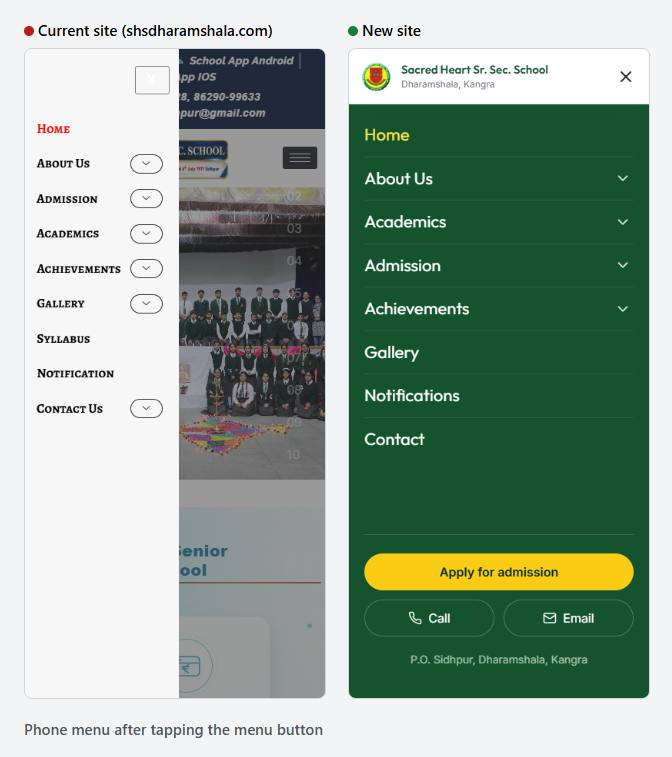
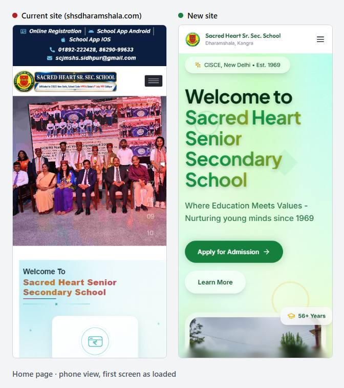
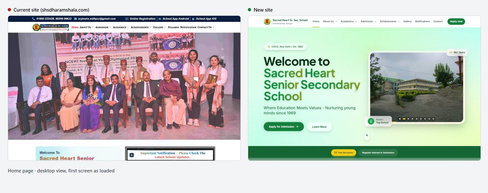
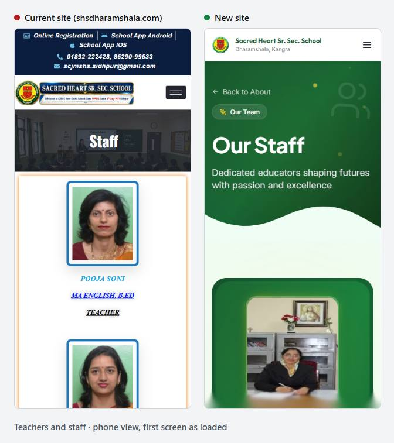
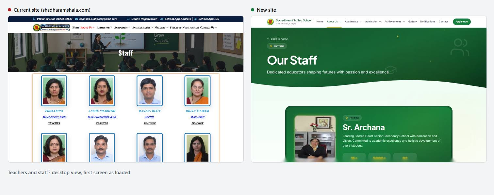

# Sacred Heart Sr. Sec. School website: current site vs proposed new site

**Current site:** https://shsdharamshala.com/ (WordPress)
**Proposed site:** this project (Next.js), tested as a production build
**Tested:** 19–20 October 2026, Google Chrome 155, Google Lighthouse 12.6.1 and axe-core 4.10 (the accessibility engine used by Google and Microsoft tools)

Every number in this document comes from a measurement taken for this comparison. The raw results are in [`comparison-assets/data/`](comparison-assets/data/). Where the new site is weaker, or is missing something the current site has, this document says so (see [section 9](#9-what-the-current-site-has-that-the-new-site-does-not-yet) and [section 11](#11-known-issues-in-the-new-site)).

---

## 1. Summary for the school

| What matters to parents and staff | Current site | New site | Difference |
|---|---|---|---|
| Google speed score on a **phone** (0–100, average of 10 matching pages) | **51** | **86** | +35 points |
| Google speed score on a **computer** | **60** | **98** | +38 points |
| Time until the main content appears on a phone (average) | **15.9 s** | **3.7 s** | 4.3× faster |
| Time until the main content appears on the **home page**, phone | **34.0 s** | **4.0 s** | 8.5× faster |
| Data downloaded to open the home page on a phone | **8.82 MB** | **0.44 MB** | 20× less |
| Data used scrolling through the whole home page on a phone | **16.93 MB** | **0.68 MB** | 25× less |
| Accessibility score (Google, average) | **84** | **100** | every page 100 |
| Accessibility errors found by axe-core on phones (all pages) | **155** | **0** | |
| Share of text smaller than 12 px on phones (hard to read) | **16.5%** (up to 48.5% on one page) | **0%** | |
| Pages with JavaScript errors or failed downloads | **2 of 24** | **0 of 28** | |
| Broken images | **6** | **0** | |
| Pages missing a main heading (H1) | **10 of 24** | **0 of 28** | |
| Pages without a description for Google results | **24 of 24** | **0 of 28** | |
| Readable web addresses | No (`?page_id=10136`) | Yes (`/admission/fee-structure`) | |

**In plain words:** the new site opens about four times faster on a phone, uses a fraction of the mobile data, and is easier to read. It has no accessibility errors and no broken parts, and gives Google better information about every page.

**Before it can replace the current site,** it needs:
1. The links to the school's existing online registration, online fee payment and school app.
2. The video gallery.
3. This session's information (principal, head boy/girl, toppers, office bearers, fee amounts).

These are listed in [section 9](#9-what-the-current-site-has-that-the-new-site-does-not-yet) and [section 12](#12-what-has-to-happen-before-switching).

---

## 2. How the comparison was done

| | |
|---|---|
| **Devices** | Phone (390 × 844, iPhone browser identity), tablet (768 × 1024, iPad identity), desktop (1440 × 900). |
| **Pages** | Current site: all 24 published pages (from the site's own page list). New site: all 28 pages. |
| **Speed** | Google Lighthouse, the same engine behind Google's PageSpeed Insights. 10 matching pages × phone and desktop × 3 runs per site (120 runs in total), median reported. Lighthouse simulates the same mobile network (slow 4G) and the same mid-range phone processor for both sites, so the comparison is like for like. |
| **Per-page checks** | Every page on every device was opened in Chrome and scrolled to the bottom like a visitor would. Measured: total data downloaded, number of downloads, sideways scrolling, text size, tap target size, broken images, JavaScript errors, failed downloads, accessibility (axe-core WCAG 2.1 A/AA), headings and page descriptions. |
| **Content** | Every current-site page was read through the site's public WordPress page list, and its menu was mapped. |
| **Links** | 592 links and images on the current site checked (see [section 7](#7-reliability-and-robustness)). |

**Fairness notes:**
- The new site is not online yet, so it was measured from a local production build. Lighthouse applies the same simulated network to both sites. What a local build cannot show is the hosting server's own response time: the current site's server took **1.4–2.8 s** to start responding (Lighthouse median per page), while the local build took about 12 ms.
- **Conservative check:** add the current site's own 1.5 s server delay to every new-site result. The new site's average phone time to main content becomes **5.2 s**, against **15.9 s** for the current site, so it is still about 3× faster.
- Data size, number of downloads, text size, accessibility and errors do not depend on hosting at all.
- **Testing side effect:** during testing, a burst of about 600 link checks caused the current site's host to block the test computer's internet address for several hours. An independent outside check confirmed the site stayed up for everyone else. The remaining current-site tests were then run from another network, one page at a time, 10 seconds apart. None of the current site's results include that blocked period.

---

## 3. What each site is built with

| | Current site | New site |
|---|---|---|
| Platform | WordPress 7.1.3 on a LiteSpeed shared server | Next.js 14 (React), every page pre-built as a static web page |
| Page builder and plugins loaded on the home page | Elementor, Elementor Pro, ElementsKit Lite, Element Pack, Prime Slider Lite, Popup Maker, Site Kit by Google, Header Footer Elementor, FileBird (**9 plugins**), on the default "Twenty Twenty" theme | None. 7 runtime packages, compiled into the site |
| Fonts | **6 Google font families** (Alegreya SC, Nunito, Prata, Raleway, Roboto, Roboto Slab), each requested in 18 weights/styles | 3 fonts (Inter, Outfit, Plus Jakarta Sans), stored with the site (no outside font service) |
| Scripts and stylesheets on the home page | 48 `<script>` and 49 stylesheet tags in the HTML | Bundled and split automatically per page |
| Home page HTML alone | 433 KB | Part of a 0.44 MB total page |
| Images | JPEG photos at full camera size ("-scaled.jpg", 0.24–0.87 MB each); all loaded up front | 304 images converted to WebP; resized for each screen; loaded only when scrolled to |
| Web addresses | `?page_id=83`, `?page_id=6424`, … | `/about`, `/about/staff`, … |
| How content is edited | WordPress dashboard (staff can edit in a browser) | Data files in the code, then a redeploy. A content system can be connected later (the code is prepared for it). **See [section 12](#12-what-has-to-happen-before-switching).** |
| Security headers (HSTS, CSP, X-Frame-Options, etc.) | None sent | None configured yet (hosting can add HSTS; see section 12) |

---

## 4. Speed

### 4.1 Phone (Lighthouse, simulated slow 4G and mid-range phone, median of 3 runs)

| Page | Speed score (current → new) | Main content appears | First content appears | Page frozen (blocking time) | Content jumping (layout shift) | Data downloaded | Downloads |
|---|---|---|---|---|---|---|---|
| Home | **14 → 85** | 34.0 s → 4.0 s | 7.7 s → 1.8 s | 1347 ms → 45 ms | 0.37 → 0.00 | 8.82 MB → 0.44 MB | 130 → 34 |
| About | **62 → 90** | 12.3 s → 3.5 s | 3.2 s → 1.7 s | 208 ms → 29 ms | 0.00 → 0.00 | 1.97 MB → 0.37 MB | 85 → 30 |
| Staff | **43 → 84** | 10.0 s → 4.0 s | 5.0 s → 1.8 s | 633 ms → 162 ms | 0.08 → 0.00 | 2.73 MB → 0.46 MB | 179 → 47 |
| Pass-out batches | **56 → 75** | 17.0 s → 4.1 s | 7.3 s → 1.8 s | 66 ms → 388 ms ⚠ | 0.07 → 0.00 | 3.07 MB → 0.56 MB | 82 → 40 |
| Admission | **63 → 90** | 13.2 s → 3.5 s | 3.2 s → 1.7 s | 230 ms → 25 ms | 0.03 → 0.00 | 2.14 MB → 0.37 MB | 93 → 29 |
| Calendar | **57 → 83** | 11.2 s → 3.5 s | 8.4 s → 1.7 s | 67 ms → 69 ms | 0.03 → 0.16 ⚠ | 1.66 MB → 0.38 MB | 80 → 32 |
| Class 10 toppers | **50 → 92** | 11.6 s → 3.1 s | 4.8 s → 1.7 s | 273 ms → 88 ms | 0.05 → 0.00 | 1.82 MB → 0.45 MB | 77 → 48 |
| Photo gallery | **54 → 81** | 23.9 s → 4.7 s | 5.1 s → 1.7 s | 219 ms → 138 ms | 0.03 → 0.00 | 5.82 MB → 0.72 MB | 114 → 50 |
| Notifications | **55 → 90** | 14.0 s → 3.5 s | 4.9 s → 1.7 s | 113 ms → 31 ms | 0.10 → 0.00 | 2.17 MB → 0.37 MB | 83 → 30 |
| Contact | **52 → 89** | 11.5 s → 3.6 s | 5.5 s → 1.7 s | 325 ms → 40 ms | 0.03 → 0.00 | 2.26 MB → 0.38 MB | 118 → 30 |
| **Average** | **51 → 86** | **15.9 s → 3.7 s** | **5.5 s → 1.7 s** | **348 ms → 102 ms** | **0.08 → 0.02** | **3.25 MB → 0.45 MB** | **104 → 37** |

⚠ = the new site is worse on that measure (explained in [section 11](#11-known-issues-in-the-new-site)).

### 4.2 Desktop (Lighthouse desktop settings, median of 3 runs)

| Page | Speed score (current → new) | Main content appears | First content appears | Content jumping | Data downloaded | Downloads |
|---|---|---|---|---|---|---|
| Home | **37 → 98** | 6.8 s → 1.0 s | 1.9 s → 0.4 s | 0.66 → 0.00 | 9.36 MB → 0.50 MB | 131 → 54 |
| About | **75 → 99** | 2.7 s → 1.0 s | 1.3 s → 0.4 s | 0.00 → 0.00 | 2.32 MB → 0.49 MB | 85 → 62 |
| Staff | **55 → 99** | 2.3 s → 0.9 s | 1.4 s → 0.5 s | 0.46 → 0.00 | 2.80 MB → 0.63 MB | 179 → 85 |
| Pass-out batches | **56 → 99** | 3.4 s → 1.0 s | 1.6 s → 0.4 s | 0.28 → 0.00 | 3.14 MB → 0.54 MB | 82 → 59 |
| Admission | **66 → 99** | 2.9 s → 0.9 s | 1.0 s → 0.4 s | 0.24 → 0.00 | 2.81 MB → 0.43 MB | 93 → 49 |
| Calendar | **69 → 87** | 2.4 s → 0.9 s | 1.5 s → 0.4 s | 0.24 → 0.24 ⚠ | 1.72 MB → 0.43 MB | 80 → 50 |
| Class 10 toppers | **61 → 100** | 2.4 s → 0.7 s | 1.6 s → 0.4 s | 0.29 → 0.00 | 1.90 MB → 0.58 MB | 78 → 76 |
| Photo gallery | **53 → 98** | 5.5 s → 1.1 s | 1.5 s → 0.4 s | 0.24 → 0.00 | 7.11 MB → 0.77 MB | 116 → 67 |
| Notifications | **61 → 99** | 2.5 s → 0.8 s | 1.5 s → 0.4 s | 0.30 → 0.00 | 2.24 MB → 0.42 MB | 83 → 47 |
| Contact | **66 → 100** | 2.6 s → 0.8 s | 1.8 s → 0.4 s | 0.17 → 0.00 | 2.29 MB → 0.42 MB | 119 → 47 |
| **Average** | **60 → 98** | **3.4 s → 0.9 s** | **1.5 s → 0.4 s** | **0.29 → 0.02** | **3.57 MB → 0.52 MB** | **105 → 60** |

**What the measures mean:**
- **Main content appears** (Largest Contentful Paint): when the biggest thing on screen, usually the main photo or heading, has loaded. Google treats under 2.5 s as good and over 4 s as poor.
- **Content jumping** (Cumulative Layout Shift): how much the page moves while loading, the "I tapped the wrong thing" problem. Under 0.1 is good; over 0.25 is poor. On a computer, the current site's home page scores 0.66.
- **Page frozen** (Total Blocking Time): how long the page ignores taps while it is busy.

### 4.3 Why the current site is slow (Lighthouse's own diagnosis of its home page, phone)

| Cause | Measured |
|---|---|
| Images below the screen loaded immediately instead of when scrolled to | **4.98 MB** could be deferred |
| Photos not in a modern format (WebP/AVIF) | **2.42 MB** could be saved |
| Photos larger than they are shown | **0.93 MB** could be saved |
| Stylesheets and scripts that block the page from showing | delay estimated at **4.8 s** |
| Main-thread work on a mid-range phone | **17.8 s** |
| A single icon font (ElementsKit) | **0.44 MB** |
| The main slide image (Prime Slider) | the largest content element, set as a CSS background, which Lighthouse measured at **43 s** in one run |

The new site avoids each of these by design:
- WebP images sized per screen;
- images load only when they come into view;
- three self-hosted fonts;
- no page-builder plugins;
- pages pre-built as static HTML.

### 4.4 Mobile data

Measured by opening each page on a phone and scrolling to the end, as a visitor would:

| | Current site | New site |
|---|---|---|
| Home page | **16.93 MB** | **0.68 MB** |
| Average page | **3.07 MB** | **0.64 MB** |
| Heaviest page | 16.93 MB (Home) | 2.56 MB (Pass-out batches, 66 photos) |
| Whole site, every page once | **73.6 MB** (24 pages) | **17.8 MB** (28 pages) |

For a parent on a prepaid mobile plan, one visit to the current home page uses about as much data as 25 visits to the new one.

---

## 5. Phone, tablet and desktop experience

Checked on every page of both sites at all three sizes (current: 24 pages × 3; new: 28 pages × 3).

| Device | Measure | Current site | New site |
|---|---|---|---|
| **Phone** | Pages that scroll sideways (broken layout) | 0 / 24 ✓ | 0 / 28 ✓ |
| | Text smaller than 12 px | **16.5%** of all text (worst page: History, **48.5%**) | **0%** |
| | Text smaller than 14 px | **57.8%** | **4.9%** |
| | Tap targets smaller than 24 × 24 px, average per page | 22.6 (Staff page: **110**) | 15.2 ¹ |
| | Images much larger than displayed | 42 | 0 |
| **Tablet** | Sideways scrolling | 0 / 24 ✓ | 0 / 28 ✓ |
| | Text under 12 px | 12.4% | 0% |
| **Desktop** | Sideways scrolling | 0 / 24 ✓ | 0 / 28 ✓ |
| | Text under 12 px | 10.7% | 0% |
| | Images much larger than displayed | 72 | 4 |

¹ On the new site these are footer text links that are 20 px tall but spaced apart, plus the hidden "skip to content" link. That meets WCAG 2.2's spacing exception, and axe's target-size check passes. On the current site's Staff page, every teacher's name is a link (pointing back to the home page), which is where the 110 comes from.

**Credit to the current site:** its layout does not break on any device. Its weaknesses on phones are small text, heavy pages and tiny tap targets, not broken layouts.

### Phone menu

Both menus work.

| | Current site | New site |
|---|---|---|
| Menu button size | 45 × 29 px | 44 × 44 px (the size Apple and Google recommend) |
| Menu style | Side drawer, small-caps serif text | Full-screen menu with expandable sections |
| Quick actions in the menu | None | "Apply for admission", Call and Email buttons |
| Keyboard and screen readers | Not tested on this site | Locks the page behind it, Escape closes it, focus stays inside |

### Visual comparison (first screen of each page, as loaded)

**Home**

| Phone | Desktop |
|---|---|
|  |  |

On a phone, the current site spends the top ~180 px on a dark contact bar and logo before any content. The new site opens with the school's name, the admission button and the campus slideshow.

**Teachers & staff**

| Phone | Desktop |
|---|---|
|  |  |

The current page shows one teacher per screen on a phone. No search box or filter was found on it, and the names and qualifications are styled as underlined links. The new page has a search box and department filters, and fits two staff cards per row on a phone.

**More pages** (each image shows both sites side by side):

| Page | Phone | Tablet | Desktop |
|---|---|---|---|
| About Us | [phone](comparison-assets/about-phone.jpg) | [tablet](comparison-assets/about-tablet.jpg) | [desktop](comparison-assets/about-desktop.jpg) |
| History | [phone](comparison-assets/history-phone.jpg) | [tablet](comparison-assets/history-tablet.jpg) | [desktop](comparison-assets/history-desktop.jpg) |
| Admission | [phone](comparison-assets/admission-phone.jpg) | [tablet](comparison-assets/admission-tablet.jpg) | [desktop](comparison-assets/admission-desktop.jpg) |
| Fee structure | [phone](comparison-assets/fee-structure-phone.jpg) | [tablet](comparison-assets/fee-structure-tablet.jpg) | [desktop](comparison-assets/fee-structure-desktop.jpg) |
| Calendar | [phone](comparison-assets/calendar-phone.jpg) | [tablet](comparison-assets/calendar-tablet.jpg) | [desktop](comparison-assets/calendar-desktop.jpg) |
| Class 10 toppers | [phone](comparison-assets/toppers-10-phone.jpg) | [tablet](comparison-assets/toppers-10-tablet.jpg) | [desktop](comparison-assets/toppers-10-desktop.jpg) |
| Photo gallery | [phone](comparison-assets/gallery-phone.jpg) | [tablet](comparison-assets/gallery-tablet.jpg) | [desktop](comparison-assets/gallery-desktop.jpg) |
| Pass-out batches | [phone](comparison-assets/pass-out-phone.jpg) | [tablet](comparison-assets/pass-out-tablet.jpg) | [desktop](comparison-assets/pass-out-desktop.jpg) |
| Notifications | [phone](comparison-assets/notifications-phone.jpg) | [tablet](comparison-assets/notifications-tablet.jpg) | [desktop](comparison-assets/notifications-desktop.jpg) |
| Contact | [phone](comparison-assets/contact-phone.jpg) | [tablet](comparison-assets/contact-tablet.jpg) | [desktop](comparison-assets/contact-desktop.jpg) |

**Design consistency:** on the current site, pages built at different times use different looks. For example, History uses a navy-and-gold card design, Staff uses blue frames and blue underlined names, and Notifications uses a dark purple card. The new site uses one green-and-gold design, one type system and one page-header style on every page.

---

## 6. Accessibility (students, parents and staff with disabilities)

| | Current site | New site |
|---|---|---|
| Google Lighthouse accessibility score (average of 10 pages, phone) | **84** | **100** (every page) |
| axe-core WCAG 2.1 A/AA errors, all pages, phone | **155** errors on 24 pages | **0** on 28 pages (also 0 on tablet and desktop) |
| Keyboard use | Not tested | Every control reachable, visible focus outline on every stop, "skip to main content" link |
| Reduced-motion setting respected | Not tested | Yes, movement animations stop (some gentle fades remain) |

What axe found on the current site (phone):

| Problem | Seriousness | Pages | Elements |
|---|---|---|---|
| Text with too little contrast against its background | serious | 24 | 83 |
| Links with no readable text (icon-only or empty) | serious | 24 | 34 |
| Visible label differs from the name read out by screen readers | serious | 24 | 24 |
| Images in a role="img" without a description | serious | 1 | 8 |
| Buttons with no readable text | **critical** | 1 | 2 |
| Hidden element that can still be focused | serious | 2 | 2 |
| Scrolling area not reachable by keyboard | serious | 1 | 1 |
| Menu/list structure invalid for screen readers | **critical** | 1 | 1 |

---

## 7. Reliability and robustness

### 7.1 Errors found on the current site (all from this test run)

| Finding | Where | Evidence |
|---|---|---|
| A test/draft page is public. It shows a raw unprocessed code (`[wpdatatable id=7]`), **20 missing images** (HTTP 404) and **20 JavaScript errors** | "Important Grid Use" (`?page_id=3562`) | Page content and device audit |
| That page links to an "Our Aims" page that does not exist (HTTP 404) | `?page_id=717` | Direct check |
| The Admission page shows a chart labelled *"Illustrative figures for demonstration, not verified school records."* | Admission (`?page_id=702`) | Page content |
| The fee-payment instructions publish the fee portal's **default password** on a public page | "Instructions For Online Fee" (`?page_id=782`) | Page content (the password is deliberately not repeated here) |
| 3 of the 5 notification slots say "Coming Soon"; the newest real notice is dated 1 July 2025 | Notification | Page content |
| The "Calendar" page is a generic Indian and world holiday widget, not the school's own calendar | Calendar | Page content |
| Every teacher's name and qualification is a link to the home page | Teachers & Office Staff | Page content |
| Menu items "Academics", "Achievements" and "Gallery" are `#` links (they only open sub-menus) | Main menu | Menu HTML |
| No `sitemap.xml` or `robots.txt` (both HTTP 404) | Site root | Direct check |
| No main heading (H1) on 10 of 24 pages, including Home, About, Admission and Contact | Device audit | |
| `/favicon.ico` missing (HTTP 404) | Fee structure page | Console |
| The server takes **1.4–2.8 s** to start responding (Lighthouse), **1.9 s** and **3.9 s** in two direct checks | Every page | Lighthouse `server-response-time`, curl |

**Link check:**
- 592 unique links and images were collected from all 24 pages.
- In the first pass, 270 opened correctly. The rest timed out, but only because the host started blocking the test computer during the check (see [section 2](#2-how-the-comparison-was-done)).
- All 320 that timed out were images. A random sample of 15 was rechecked slowly later, and all 15 loaded (0.24–0.84 MB each).
- So apart from the draft page above, **no broken links were found**.

### 7.2 The new site's test results

| Test | Result |
|---|---|
| Automated checks of forms, calendar and fixes for 48 previously logged issues | **30/30** and **75/75** passed |
| Accessibility (axe-core WCAG 2.0–2.2 A/AA + best practice), all 28 pages at phone and desktop | **0 violations** |
| Layout sweep at **40 screen widths** (320 px to 2560 px, plus live resizing) on all 28 pages | No sideways scrolling and no overlapping content |
| Keyboard sweep (7 representative pages, phone and desktop) | Every stop visibly focused; no focus lands on hidden content |
| JavaScript errors / failed downloads / broken images, 28 pages × 3 devices | **0 / 0 / 0** |
| Build and code checks | Production build passes, TypeScript clean, linter reports no warnings |

### 7.3 Robustness by design

| | Current site | New site |
|---|---|---|
| What runs on the server per visit | WordPress (PHP + database) plus 9 plugins | Nothing; pages are pre-built files |
| Things that need regular security updates | WordPress core, 9 plugins, a theme | Website packages, updated when the site is rebuilt |
| If a plugin update breaks something | Can break live pages (e.g. the raw shortcode above) | Each change is built and checked before it goes live |
| Forms | A careers form with file upload and a sum-based captcha (`14 + 10 =`) | Form checks every field and **never shows "submitted" unless a real destination confirmed it**. Today it prepares an email to the school (see section 12) |

---

## 8. Navigation and finding things

| | Current site | New site |
|---|---|---|
| Top-level menu | Home, About Us, Admission, Academics, Achievements, Gallery, Syllabus, Notification, Contact Us | Home, About Us, Academics, Admission, Achievements, Gallery, Notifications, Contact, plus an "Apply now" button |
| Web addresses | `?page_id=…` numbers | Readable paths (e.g. `/admission/fee-structure`) |
| Every page title and description for Google | Titles yes; **no descriptions on any page** | Unique title and description on all 28 pages (28 different titles) |
| Back links on sub-pages | No | "Back to About / Academics / Admission …" on every sub-page except the Class 10/12 toppers pages, which link to each other |
| Search and filters | None | Staff search and department filter; pass-out batch search and year filter; gallery category filter |
| Phone actions | Phone numbers are tappable | Phone and email tappable in the header menu, footer, contact page and admission notices |
| Error page | WordPress "Page not found" page with the normal menu | A branded "page not found" page with links back into the site |

---

## 9. What the current site has that the new site does not yet

The school will notice these, so they need to be in place before switching:

| Current site has | New site today | Effort to add |
|---|---|---|
| **Online registration** via the school's iqdigit portal (`shsd.iqdigit.com`), with CAPTCHA and age-eligibility check | A "Register interest" form that prepares an email to the school; **no link to the real portal** | Small: add links to the existing portal |
| **Online fee payment** guide with "Pay now" link to the portal | No fee-payment link or guide | Small: add the link and a rewritten guide (**without** the default password) |
| **School app** links (Android and iOS) | None | Small |
| **Alumni registration** link | None | Small |
| **Video gallery** (3 YouTube videos) | None | Small to medium |
| **Prayer and Anthem** page with the anthem video | Anthem text on the About page; no video | Small |
| **Class-wise fee table, session 2026–27** (interactive, by class and quarter) | Fee guidelines only; no amounts | Medium: needs the fee data |
| **Careers form** with resume upload, and an **embedded map** on Contact | Contact page with call, email and "open in Google Maps" link; no careers form | Medium (a form needs a real destination) |
| Photo gallery: 79 images | Gallery: 20 event albums; pass-out page: 66 batch photos | Copy any missing albums |
| WordPress dashboard: office staff can edit pages in a browser | Content is edited in data files and redeployed | Decision needed (section 12) |

## 10. Content currency (the new site is one session behind)

The current site has been updated for 2026–27. The new site still holds the previous session in these places:

| Item | Current site (live) | New site |
|---|---|---|
| Principal | **Sr. Gracy M.D** | Sr. Archana |
| Head Boy / Head Girl | **Udit Thakur / Mehul Dhiman (2026–27)** | 2025–26 pair |
| Office bearers | **Session 2026** | Latest is session 2025 |
| Class 10 toppers | **ICSE 2025–26** (top: 98.4%) | Latest is 2024–25 |
| Class 12 toppers | **ISC 2025–26** (top: 97.75%) | Latest is 2024–25 |
| Fees | **Session 2026–27 amounts** | No amounts |

None of these need design work; they are data updates.

---

## 11. Known issues in the new site

| Issue | Measured | Fix |
|---|---|---|
| Calendar page content jumps while loading | Layout shift 0.16 (phone), 0.24 (desktop); the month grid moves as the font and today's date load | Reserve the grid's space before load |
| Pass-out page is busy on slower phones | Blocking time 388 ms (current site 66 ms) with 66 photos and 46 batches | Load batch photos more gradually |
| One link says only "Learn More" | Lighthouse SEO 91 on the home page (100 elsewhere) | Make the link text specific |
| "Ranked Top School" badge on the home page | No source for this claim | Confirm with the school or remove |
| No `sitemap.xml` / `robots.txt` | Missing on both sites | Add both (Next.js generates them) |
| No security headers | Missing on both sites | Add in the site config or hosting |
| Not yet online | — | Choose hosting (section 12) |

---

## 12. What has to happen before switching

1. **Carry over the essentials** from section 9: registration portal, fee payment, app links, alumni link, video gallery.
2. **Update the content** in section 10 to session 2026–27.
3. **Decide how content will be edited.** Either:
   - the developer updates the data files, which is simple and has no running cost; or
   - a content management system is connected so office staff can edit in a browser. The site is already structured for this.
4. **Decide where the admission form sends data.** It currently prepares an email. A form service or the existing iqdigit portal can receive it directly.
5. **Host the site.** As static pages it can run on a static host or CDN.
6. **Point the domain** `shsdharamshala.com` to the new site. Keep the old WordPress site available for a short overlap if needed.
7. **Fix the items in section 11.**

---

## 13. How this helps the school

| Benefit | Based on |
|---|---|
| **Parents on phones get information about 4× faster** | Main content appears in 3.7 s instead of 15.9 s on a simulated mid-range phone over slow 4G |
| **Less mobile data for families** | Home page 0.68 MB instead of 16.93 MB per visit |
| **A better first impression for prospective parents** | Home page speed score on phones 85 instead of 14; consistent design across every page |
| **Easier to read and use for everyone, including people with disabilities** | 0 accessibility errors instead of 155; no text under 12 px instead of 16.5% |
| **Fewer embarrassing errors** | No draft pages, placeholder charts, "Coming Soon" notices, raw code or published passwords |
| **Easier to find on Google** | A description on every page (currently none), a main heading on every page, readable web addresses |
| **Lower maintenance risk** | No WordPress, plugins or database to keep patched; each change is built and checked before going live |
| **Admissions in front** | "Apply now" in the header on every page; fee structure, registration and calendar one tap away from the home page |

---

## Appendix A: Page mapping used for the speed tests

| Page | Current site | New site |
|---|---|---|
| Home | `/` | `/` |
| About | `?page_id=83` | `/about` |
| Staff | `?page_id=6424` | `/about/staff` |
| Pass-out batches | `?page_id=718` | `/about/pass-out-batches` |
| Admission | `?page_id=702` | `/admission` |
| Calendar | `?page_id=780` | `/academics/calendar` |
| Class 10 toppers | `?page_id=2097` | `/achievements/toppers/10th` |
| Photo gallery | `?page_id=756` | `/gallery` |
| Notifications | `?page_id=648` | `/notifications` |
| Contact | `?page_id=84` | `/contact` |

## Appendix B: Lighthouse category scores (median, phone / desktop)

| Page | Accessibility | Best practices | SEO |
|---|---|---|---|
| Home | 83/85 → 100/100 | 96/96 → 100/100 | 83/83 → 91/91 |
| About | 86/87 → 100/100 | 96/96 → 100/100 | 92/92 → 100/100 |
| Staff | 80/81 → 100/100 | 96/96 → 100/100 | 92/92 → 100/100 |
| Pass-out batches | 86/88 → 100/100 | 96/96 → 100/100 | 92/92 → 100/100 |
| Admission | 86/87 → 100/100 | 96/96 → 100/100 | 92/92 → 100/100 |
| Calendar | 81/84 → 100/100 | 96/96 → 100/100 | 92/92 → 100/100 |
| Class 10 toppers | 86/87 → 100/100 | 96/96 → 100/100 | 92/92 → 100/100 |
| Photo gallery | 86/87 → 100/100 | 96/96 → 100/100 | 92/92 → 100/100 |
| Notifications | 82/84 → 100/100 | 96/96 → 100/100 | 92/92 → 100/100 |
| Contact | 88/89 → 100/100 | 96/96 → 100/100 | 92/92 → 100/100 |

## Appendix C: Raw data

| File | Contents |
|---|---|
| [`comparison-assets/data/lh-old.jsonl`](comparison-assets/data/lh-old.jsonl), [`lh-new.jsonl`](comparison-assets/data/lh-new.jsonl) | Every Lighthouse run (60 per site) |
| [`comparison-assets/data/audit-old.json`](comparison-assets/data/audit-old.json), [`audit-new.json`](comparison-assets/data/audit-new.json) | Device audit, every page × device |
| [`comparison-assets/data/tables.md`](comparison-assets/data/tables.md), [`summary.json`](comparison-assets/data/summary.json) | Tables and averages generated from the above |
| [`comparison-assets/data/live-site-pages.json`](comparison-assets/data/live-site-pages.json) | The current site's 24 published pages |
| [`comparison-assets/data/live-site-linkcheck-first-pass.json`](comparison-assets/data/live-site-linkcheck-first-pass.json) | First-pass link check (includes the timeouts explained in section 7) |

**Not covered by this comparison:**
- Safari and Firefox.
- Real phones (all device tests were simulated in Chrome).
- Screen-reader testing with real assistive technology.
- The new site's speed on its final host.
